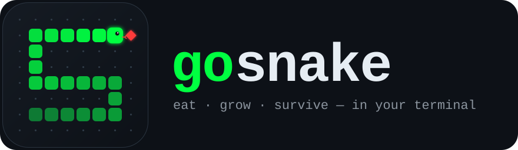

<p align="center">
  
</p>

<p align="center">
  <a href="https://github.com/HilthonTT/gosnake/actions/workflows/ci.yml"></a>
  <a href="https://github.com/HilthonTT/gosnake/releases/latest"></a>
  <a href="go.mod"></a>
  <a href="LICENSE"></a>
</p>

**gosnake** is a snake game for the terminal, built with [Bubble Tea v2](https://github.com/charmbracelet/bubbletea). Play solo, dodge bombs in crazy mode, take on a computer opponent, or host a multiplayer room over SSH. An optional ASP.NET Core service (`Tips.Api`) provides an online leaderboard and live tips over server-sent events.

## Features

- **Normal mode**: classic snake. Speed increases with every level.
- **Crazy mode**: timed bombs blink as a warning, then turn lethal. More bombs appear as you level up.
- **VS AI mode**: share the board with a pathfinding AI. Cut it off to win, but don't collide head-on.
- **SSH multiplayer**: up to 3 players per room (more can join as spectators), with optional room passwords.
- **Local leaderboard**: scores are stored in SQLite, with search and sorting by score, level, name, mode or date.
- **Online leaderboard (optional)**: scores are submitted to `Tips.Api`, which streams leaderboard changes live.
- **Configurable keys**: set your own key bindings in a TOML config file.
- **Crash reports**: if the game panics, it writes a JSON report with the last 500 UI events and the game state.

## Install

```sh
# With Go 1.26+
go install github.com/HilthonTT/gosnake/cmd/gosnake@latest
```

Or download a prebuilt binary for Linux, macOS or Windows from the [releases page](https://github.com/HilthonTT/gosnake/releases).

## Play

```sh
gosnake                          # open the menu
gosnake play                     # jump straight into normal mode
gosnake play crazy -l 5 -n neo   # crazy mode, starting at level 5, as "neo"
gosnake play ai                  # versus the AI
gosnake leaderboard              # browse local scores
gosnake --version
```

| Action         | Default keys            |
| -------------- | ----------------------- |
| Move           | `↑ ↓ ← →`, `w a s d`, `k j h l` |
| Pause / resume | `p`, `esc`              |
| Quit / continue after game over | `q`     |
| Help           | `?`                     |
| Force quit     | `ctrl+c`                |

On the leaderboard: `/` searches, and `s` `l` `n` `m` `d` sort by score, level, name, mode and date (press again to reverse the order).

## Configuration

gosnake reads `config.toml` from your XDG config directory (for example `~/.config/gosnake/config.toml`, or `%LOCALAPPDATA%\gosnake\config.toml` on Windows). Any setting you leave out keeps its default.

```toml
[keys]
up    = ["up", "w", "k"]
down  = ["down", "s", "j"]
left  = ["left", "a", "h"]
right = ["right", "d", "l"]
pause = ["p", "esc"]
quit  = ["q"]
help  = ["?"]
force_quit = ["ctrl+c"]

[leaderboard]
# Submit finished games to a Tips.Api instance. Leave empty to stay offline.
api_url = ""
# Only for local development against a self-signed certificate.
insecure_skip_verify = false
```

| Flag / env var | Purpose |
| --- | --- |
| `--config`, `GOSNAKE_CONFIG` | Config file path |
| `--db`, `GOSNAKE_DB` | SQLite database path (defaults to the XDG data directory) |
| `--log-file`, `GOSNAKE_LOG_FILE` | Log file path, or `-` for stderr (defaults to the XDG state directory) |
| `--log-level`, `GOSNAKE_LOG_LEVEL` | `DEBUG`, `INFO`, `WARN` or `ERROR` |
| `GOSNAKE_API_URL` | Overrides `leaderboard.api_url` |

## Multiplayer over SSH

Start a server:

```sh
gosnake serve --port 2222
# or with Docker
docker run -p 2222:2222 -v gosnake-data:/data ghcr.io/hilthontt/gosnake
```

Then each player connects with an SSH key:

```sh
ssh alice@your-host -p 2222 -t my-room            # open room
ssh bob@your-host   -p 2222 -t my-room secret     # password-protected room
```

The game starts once two players have joined. The first person to create a room sets its password. Rooms close after 3 minutes without activity. The server rate-limits connections per IP and overall.

## Online leaderboard (Tips.Api)

`Tips.Api/` is an ASP.NET Core 10 minimal API that serves:

| Endpoint | Description |
| --- | --- |
| `GET  /api/v1/leaderboard?top=N` | Top scores (output-cached for 10 s) |
| `POST /api/v1/leaderboard` | Submit a score (rate-limited to 5 per minute per IP) |
| `GET  /api/v1/leaderboard/{id}` · `/player/{name}` | Look up one entry, or all entries for a player |
| `GET  /api/v1/leaderboard/realtime` | Live leaderboard changes (SSE, resumes from `Last-Event-ID`) |
| `GET  /api/v1/tips` · `/tips/realtime` | Snake tips, filterable by `difficulty` and `category` |
| `GET  /health` | Health check |

```sh
dotnet run --project Tips.Api           # http://localhost:5000, Swagger UI at /swagger in Development
GOSNAKE_API_URL=http://localhost:5000 gosnake
```

> The leaderboard is stored in memory and `DELETE /api/v1/leaderboard/{id}` has no authentication. Treat the service as a demo, not a production deployment.

## Architecture

```text
cmd/gosnake/             CLI entry point (kong): menu, play, leaderboard, serve
pkg/snake/               Pure game engine: no I/O, no UI
├── modes/single/        Classic rules, with hooks other modes plug into
├── modes/crazy/         single + timed bombs (composition via hooks)
├── modes/ai/            1v1 vs a pluggable "Brain" (default: BFS + flood-fill pathfinder)
└── modes/multi/         Authoritative multiplayer state, simultaneous move resolution
internal/tui/            Bubble Tea v2 views: starter (router + crash capture), menu, game, leaderboard
internal/server/         Wish v2 SSH server: rooms, players, rate limiting
internal/data/           SQLite (pure-Go modernc driver) leaderboard repository
internal/services/       HTTP + SSE client for Tips.Api
internal/config/         TOML configuration
internal/telemetry/      Message recorder and crash reports
Tips.Api/                ASP.NET Core 10 service; Tips.Api.Tests/ holds its xUnit tests
```

The engine (`pkg/snake`) is independent of the UI and the database. Views talk to it through the `snake.GameController` interface, and dependencies such as key bindings and the score submitter are injected into views rather than created inside them.

## Development

```sh
go test -race ./...                     # Go unit + integration tests (includes a real SSH round-trip)
golangci-lint run                       # lint (config in .golangci.yml)
dotnet test Tips.slnx                   # Tips.Api tests
docker build -t gosnake .               # SSH server image
docker build -t tips-api Tips.Api       # API image
```

CI (`.github/workflows/ci.yml`) runs these checks on every push and pull request:

- Go tests on Linux, macOS and Windows
- golangci-lint
- .NET build and tests
- Docker builds for both images

Pushing a `v*` tag runs `release.yml`. It publishes cross-platform binaries with GoReleaser and pushes multi-arch images to `ghcr.io/hilthontt/gosnake` and `ghcr.io/hilthontt/tips-api`. Dependabot keeps Go modules, NuGet packages, Docker base images and Actions up to date.

## License

[MIT](LICENSE)
