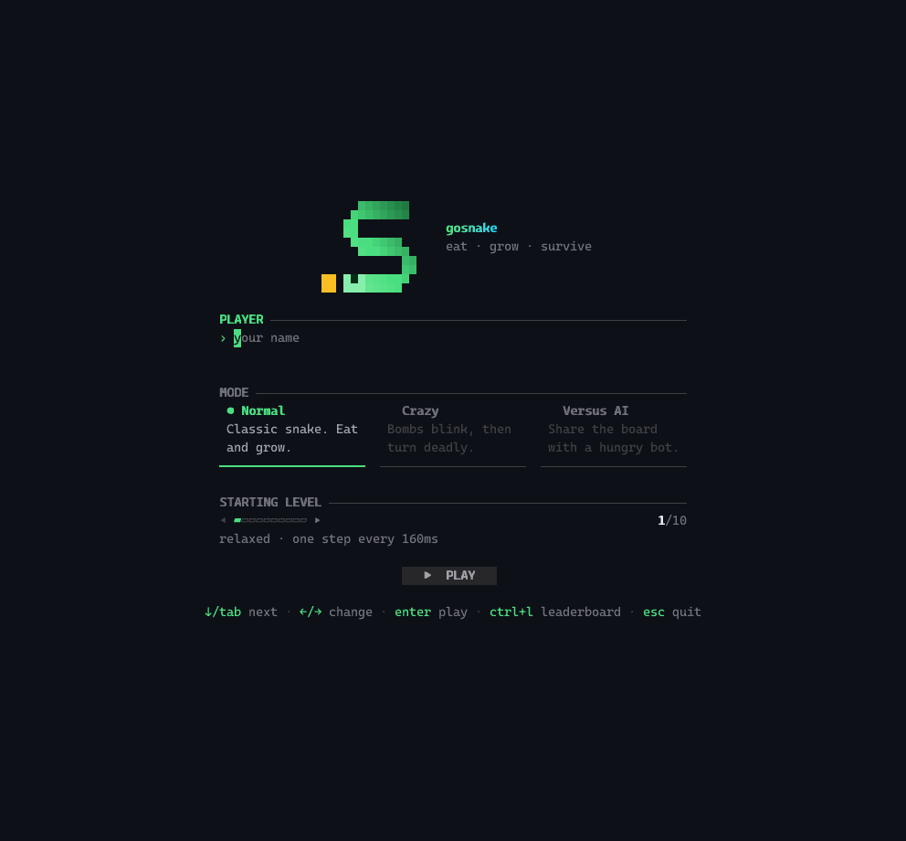
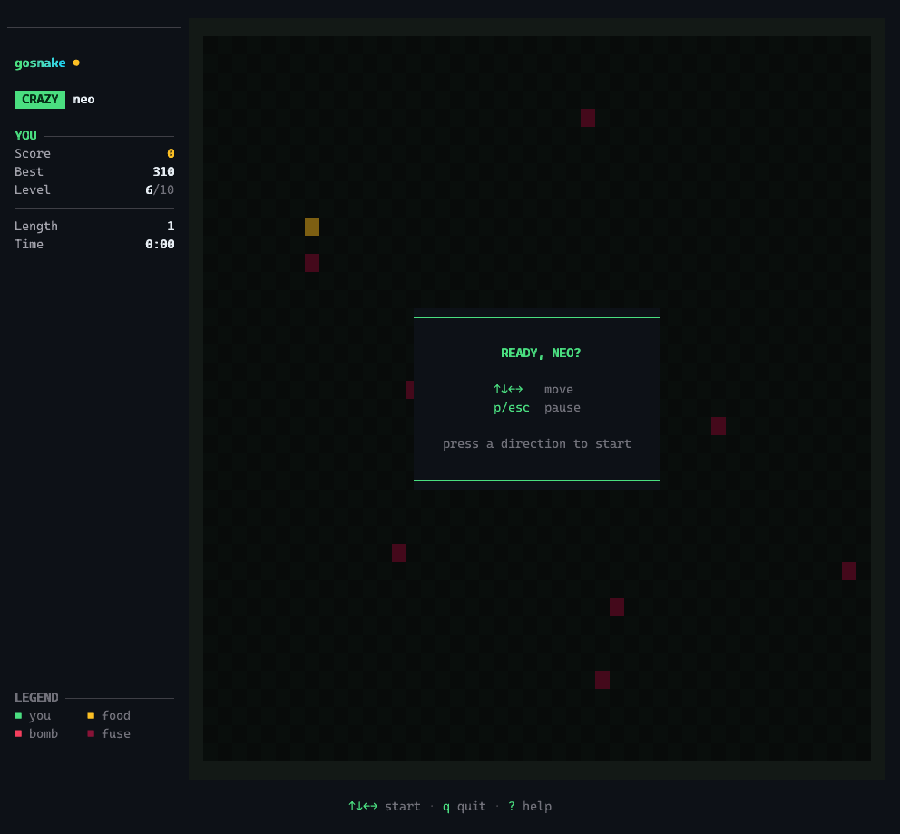
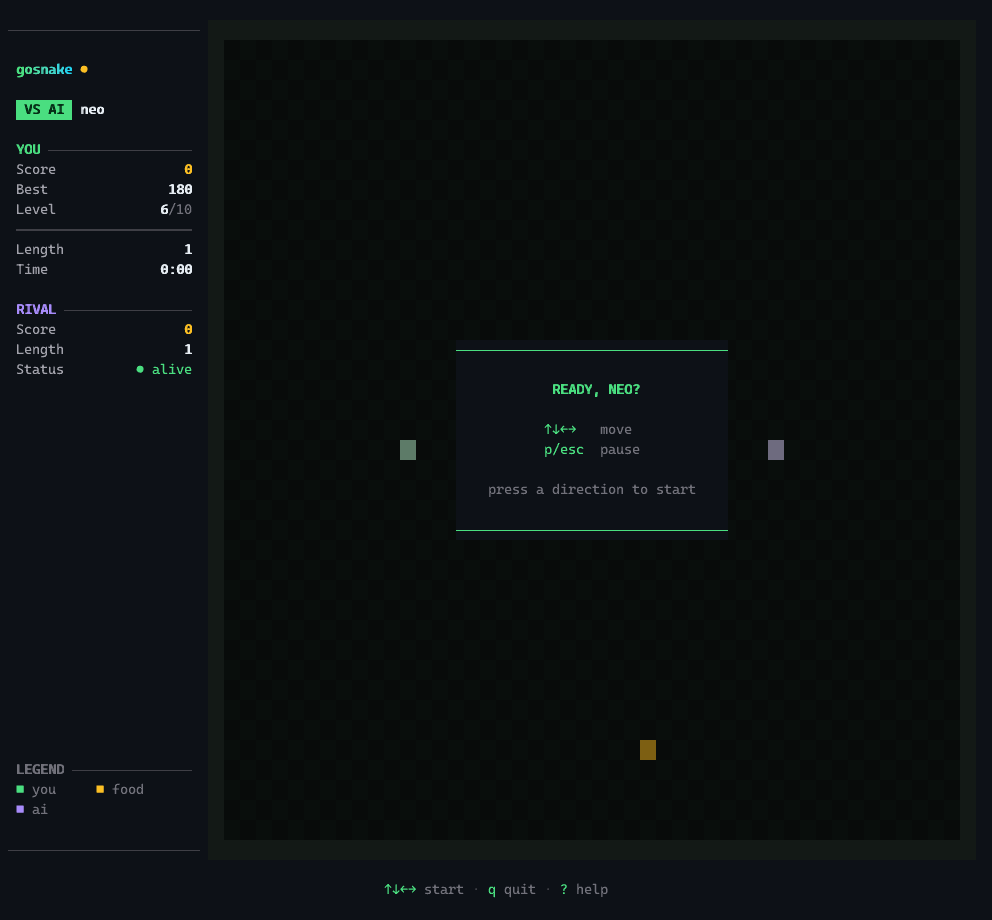

<p align="center">
  
</p>

<h1 align="center">gosnake</h1>

<p align="center">
  Snake for your terminal: solo, crazy bombs, versus AI and SSH multiplayer.<br>
  Built with <a href="https://github.com/charmbracelet/bubbletea">Bubble Tea v2</a>.
</p>

<p align="center">
  <a href="https://github.com/HilthonTT/gosnake/actions/workflows/ci.yml"></a>
  <a href="go.mod"></a>
  <a href="LICENSE"></a>
</p>

<p align="center">
  
</p>

| Crazy: bombs blink, then turn lethal | Versus AI: outlast a pathfinding bot |
| :---: | :---: |
|  |  |

## Install

```sh
go install github.com/HilthonTT/gosnake/cmd/gosnake@latest
```

Or grab a binary for Linux, macOS or Windows from the [releases page](https://github.com/HilthonTT/gosnake/releases).

## Play

```sh
gosnake                          # menu
gosnake play crazy -l 5 -n neo   # jump into a mode (normal, crazy, ai) at a level, as a player
gosnake leaderboard              # local scores
gosnake serve --port 2222        # host SSH multiplayer
```

Move with `↑↓←→`, `wasd` or `hjkl`, pause with `p`/`esc`, show every key with `?`. On the leaderboard, `/` searches and `s` `l` `n` `m` `d` sort by score, level, name, mode or date.

Scores are saved locally in SQLite. If you set an online leaderboard URL (see below), finished games are also submitted there.

<details>
<summary><b>Configuration</b></summary>

gosnake reads `config.toml` from your XDG config directory (`~/.config/gosnake/` on Linux, `%LOCALAPPDATA%\gosnake\` on Windows). Settings you leave out keep their defaults.

```toml
[keys]
up    = ["up", "w", "k"]
down  = ["down", "s", "j"]
left  = ["left", "a", "h"]
right = ["right", "d", "l"]
pause = ["p", "esc"]
quit  = ["q"]
help  = ["?"]
force_quit = ["ctrl+c"]

[leaderboard]
api_url = ""                  # a Tips.Api URL; empty stays offline
insecure_skip_verify = false  # local development only
```

Flags and environment variables: `--config`/`GOSNAKE_CONFIG`, `--db`/`GOSNAKE_DB`, `--log-file`/`GOSNAKE_LOG_FILE` (`-` for stderr), `--log-level`/`GOSNAKE_LOG_LEVEL`, and `GOSNAKE_API_URL`, which overrides `api_url`.

If the game crashes, it writes a JSON crash report with the last 500 UI events and the game state.

</details>

<details>
<summary><b>Multiplayer over SSH</b></summary>

```sh
gosnake serve --port 2222
# or
docker run -p 2222:2222 -v gosnake-data:/data ghcr.io/hilthontt/gosnake
```

Players connect with an SSH key, naming a room and optionally a password:

```sh
ssh alice@your-host -p 2222 -t my-room
ssh bob@your-host   -p 2222 -t my-room secret
```

Up to 3 people play per room, and anyone else watches. The game starts once two players are in. After a round, waiting spectators take any free slots. Rooms close after 3 minutes of inactivity, and connections are rate-limited per IP and overall.

</details>

<details>
<summary><b>Online leaderboard (Tips.Api)</b></summary>

[`tips-api/`](tips-api) is an optional ASP.NET Core 11 minimal API. It stores scores, streams leaderboard changes and gameplay tips over server-sent events, and exposes `/health`.

```sh
dotnet run --project tips-api/Tips.Api     # Swagger UI at /swagger in Development
GOSNAKE_API_URL=http://localhost:5000 gosnake
```

Endpoints live under `/api/v1`: `leaderboard` (GET top N, POST a score, `/{id}`, `/player/{name}`, `/realtime`) and `tips` (`/realtime`). Scores are kept in memory and deletion is unauthenticated, so treat it as a demo service.

</details>

<details>
<summary><b>Architecture</b></summary>

```text
cmd/gosnake/        CLI entry point: menu, play, leaderboard, serve
pkg/snake/          Game engine with no I/O or UI; modes: single, crazy, ai, multi
internal/tui/       Bubble Tea views, theme and components
internal/server/    Wish SSH server: rooms, players, rate limiting
internal/data/      SQLite leaderboard (pure-Go driver)
internal/tipsapi/   Client for the online leaderboard
tips-api/           ASP.NET Core 11 service and tests
scripts/demo/       Records the GIFs in this README
```

Views talk to the engine only through `snake.GameController`, and their dependencies (key bindings, score submitter) are injected.

</details>

## Development

```sh
make test       # go test -race ./...
make lint       # golangci-lint
make api-test   # dotnet test tips-api/Tips.slnx
go run ./scripts/demo -out docs/assets   # re-record the GIFs
```

CI runs Go tests on Linux, macOS and Windows, lints, tests the API and builds both Docker images. Pushing a `v*` tag publishes binaries with GoReleaser, plus images to `ghcr.io/hilthontt/gosnake` and `ghcr.io/hilthontt/tips-api`. See [CONTRIBUTING.md](CONTRIBUTING.md) for more.

## License

[MIT](LICENSE)
